  

  
  
  
  
  

Since 2015, TrustEngineers has designed, built, and shipped production software for clients in the US and worldwide. Today our senior engineers focus on AI-powered products. We work on fixed-price milestones, deliver on time, and keep you informed in writing at every step.

The company was founded by Leomer, a full-stack and AI engineer, and is headquartered in Murrieta, California. The team works remotely.

  

## What we do

| | |
|---|---|
| 🤖 **[AI application development](https://trustengineers.space/services#ai)** | LLM integration (OpenAI, Claude), RAG over your own data, agents and workflows with LangChain and LangGraph, MCP servers and clients, and chat assistants inside SaaS products. |
| 🧊 **[Interactive 3D web](https://trustengineers.space/services#3d)** | Product configurators, immersive landing pages, and real-time 3D with Three.js, React Three Fiber, WebGL, WebGPU and GLSL shaders, tuned for mobile devices. |
| 🧱 **[Full-stack product builds](https://trustengineers.space/services#fullstack)** | Next.js, React and TypeScript front ends, Firebase and Python back ends, Stripe payments, and PWAs and Android builds from one codebase. |
| 🧭 **[Technical leadership](https://trustengineers.space/services#leadership)** | Architecture decisions, code review and contractor oversight for teams that need a senior lead. Offered as a weekly retainer. |
| ♿ **[Accessibility and QA](https://trustengineers.space/services#qa)** | Keyboard-only and screen reader testing, real-device verification, and CI checks that catch regressions before release. |
| 🧪 **[AI training and evaluation](https://trustengineers.space/ai-training)** | Senior software engineers for RLHF, preference ranking, code evaluation, red-teaming, and data annotation. |

## Selected work

Client names are withheld to respect confidentiality. Details are available under NDA.

| Project | What we built |
|---|---|
| **[Cognitive Fitness Platform](https://trustengineers.space/work/cognitive-fitness)** Consumer health / EdTech | A progressive web app with 25 brain-training games and a timed cognitive assessment. |
| **[Dental Revenue Cycle Automation](https://trustengineers.space/work/dental-rcm)** Healthcare / Dental billing | A platform that connects insurance payers to dental practice management systems. It verifies benefits before appointments, checks claims against clinical notes, and posts insurance payments back into the practice's system. |
| **[Construction Field Operations Platform](https://trustengineers.space/work/field-operations)** Construction | A revenue assurance platform for electrical and industrial contractors. It tracks labor and materials from purchase order to paid invoice, so contractors can bill every dollar with the right backup documents. |
| **[AI Document Suite](https://trustengineers.space/work/ai-document-suite)** Productivity software | A desktop office suite with an AI assistant. Our focus was a faithful AI-powered PDF editor: any PDF opens and exports looking like the original, while its text, images, tables, and vector elements stay editable. |

## Open source

Small agents we built in the open, each with tests and an eval you can re-run.

| Repository | What it is |
|---|---|
| **[support-ticket-triage-agent](https://github.com/trustengineers/support-ticket-triage-agent)** | A Python agent that classifies support tickets, searches a help center, and drafts a reply or escalates to a human. Hand-written tool-calling loop, FastAPI, SQLite, and a two-model cost and accuracy eval. |
| **[issue-triage-agent](https://github.com/trustengineers/issue-triage-agent)** | A read-only TypeScript agent that triages a repository's GitHub issues: type, priority, labels, duplicates, and questions for the reporter. |
| **[market-watch-agent](https://github.com/trustengineers/market-watch-agent)** | A LangGraph research agent that sends a daily brief on the US remote job market, with web search, dedup memory, and output validation. |

## Latest insight

**[We ran one support agent on an $8 model and a $0.10 model](https://trustengineers.space/insights/cheap-vs-frontier-model-support-triage)** (November 10, 2026). On 20 support tickets, a model that costs 80 times less matched the frontier model on classification and cost about 1% as much per ticket.

More briefs on AI tools, AI training trends, and engineering practice are on **[Insights](https://trustengineers.space/insights)**.

## How we work

  

## AI training and evaluation

Our engineers have worked on live AI training tasks for more than a year, on DataAnnotation, LinkedIn AI Trainer (GreenLight), Snorkel, AfterQuery, Handshake, and other platforms. The work covers code evaluation and generation, RLHF and preference ranking, rubric and prompt design, web development evaluation, red-teaming, and data annotation.

On DataAnnotation, our engineers have a 100% pass rate on the qualification assessments, and one team member works there as a regular reviewer. See **[AI Training](https://trustengineers.space/ai-training)** for details.

We also run **[coaching](https://trustengineers.space/coaching)** for developers in Latin America and the US who want to qualify for and succeed on AI training projects.

Platform names describe our team's experience. TrustEngineers is not affiliated with or endorsed by these companies.

## Stack

## Work with us

An NDA is available on request. To start a project, use the **[contact form](https://trustengineers.space/contact)** or email **contact@trustengineers.space** with what you're building. We reply in writing.

We're also looking for senior engineers who want long-term collaboration: see **[Careers](https://trustengineers.space/careers)**.
